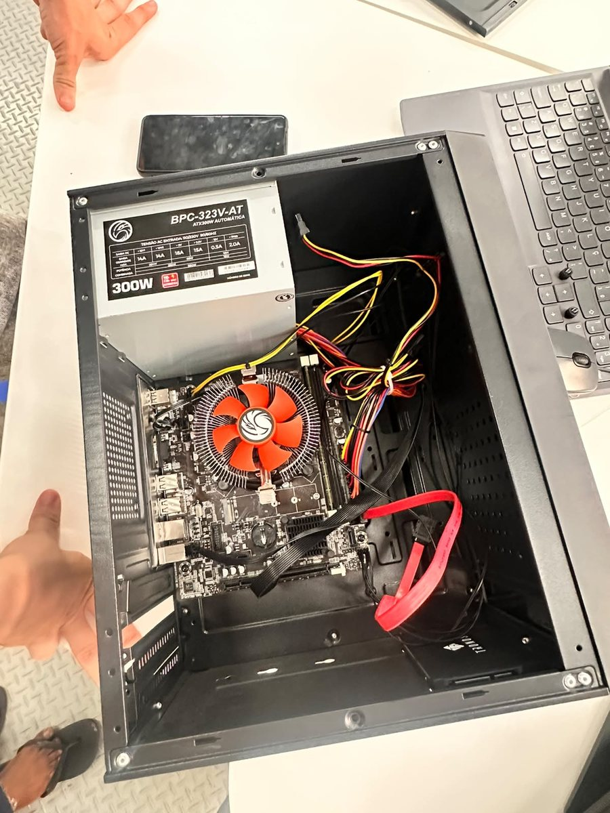
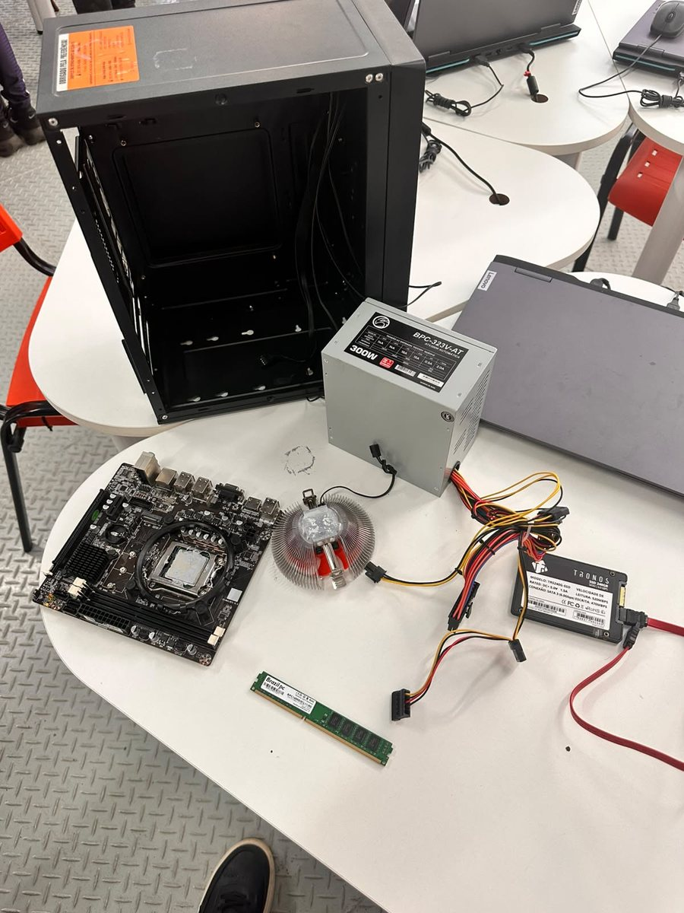
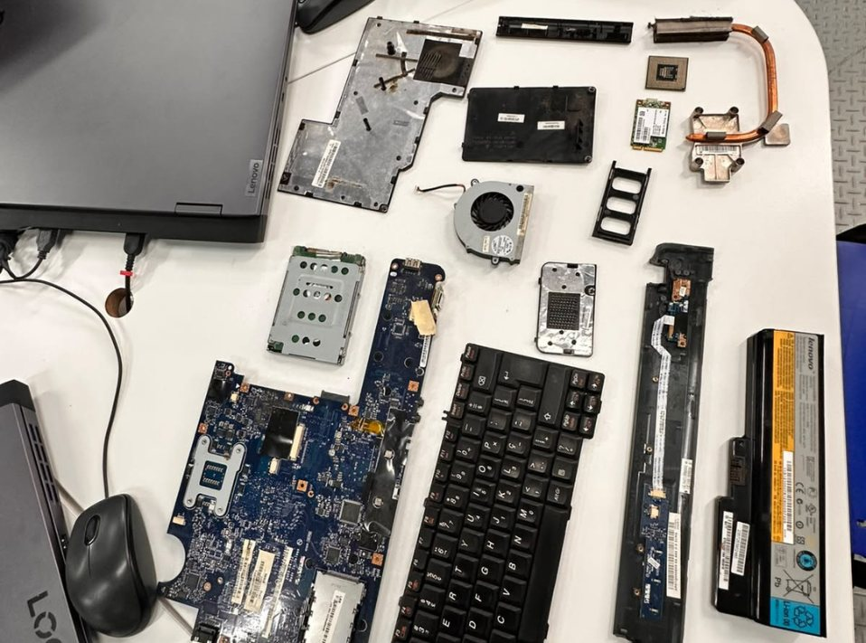

<div align="center">
  

  <h1>PC Lab</h1>
  <p><strong>Aprenda. Monte. Cuide.</strong></p>
  <p>Uma plataforma interativa para explorar hardware, montagem e manutenção de computadores.</p>

  <p>
    <a href="https://lucasassisfranca.github.io/PC-Lab/"><strong>Acessar o PC Lab</strong></a>
    &nbsp;·&nbsp;
    <a href="https://github.com/lucasassisfranca/PC-Lab"><strong>Ver repositório</strong></a>
  </p>
<<<<<<< HEAD

  
=======
  
>>>>>>> c87e44be5ced869347dc60ee45c63083f8097eb3
  <br>
  <sub>Aprendizado conectado à prática: montagem de um computador em laboratório.</sub>
</div>

---

## Sobre o projeto

O **PC Lab** reúne conteúdos e experiências interativas para tornar o aprendizado sobre computadores mais visual e acessível. A plataforma combina um gabinete 3D explorável com guias e laboratórios sobre montagem, compatibilidade, diagnóstico, manutenção, sistemas operacionais, cabos e redes.

O projeto foi desenvolvido como uma experiência educativa para computadores e tablets compatíveis. A interface apresenta conceitos em etapas, exemplos e simulações, sem exigir instalação de dependências para começar.

## Explore a plataforma

| Área | O que você encontra |
| --- | --- |
| **Computador 3D** | Explore componentes internos, selecione peças e alterne entre as vistas lateral, frontal e traseira. |
| **Montagem guiada** | Acompanhe as etapas de montagem com ferramentas, cuidados e erros comuns. O progresso é salvo no navegador. |
| **Compatibilidade** | Compare processador, placa-mãe, memória, gabinete, placa de vídeo, armazenamento e fonte em verificações interativas. |
| **Simulador de configuração** | Monte uma configuração de referência e consulte verificações de compatibilidade e dimensões. |
| **Diagnóstico** | Investigue sintomas comuns por meio de perguntas e sugestões de verificação. |
| **Manutenção** | Organize rotinas preventivas por periodicidade e acompanhe tarefas concluídas. |
| **Sistemas operacionais** | Explore uma simulação didática de inicialização, particionamento e instalação. |
| **Cabos e conexões** | Consulte representações visuais de conectores, pinagens e padrões de conexão. |
| **Redes** | Aprenda conceitos de redes com diagramas e atividades interativas. |

As verificações de compatibilidade são educativas e usam modelos e dados de referência incluídos no projeto. Para uma compra ou montagem real, confirme as especificações do modelo exato com os fabricantes.

## Da prática ao aprendizado

As fotografias abaixo são registros reais das atividades práticas relacionadas à formação que inspirou o projeto. Elas não são capturas de tela da interface.

<div align="center">
  
  &nbsp;
  
</div>

<div align="center">
  <sub>Componentes e procedimentos observados em atividades de montagem e manutenção.</sub>
</div>

> **Sobre as imagens:** o repositório inclui o logotipo do PC Lab e fotografias de atividades práticas. Não há capturas de tela estáticas do site entre os assets; a imagem principal da interface é o próprio computador 3D interativo disponível na plataforma.

## Tecnologias

<div>
  
  
  
  
</div>

- **HTML, CSS e JavaScript** compõem uma aplicação web estática, sem framework ou etapa de build.
- **Three.js r128** renderiza o computador 3D e é carregado por CDN.
- **Google Fonts (Sora)** fornece a tipografia e também é carregada externamente.
- O progresso de montagem e as marcações de manutenção são guardados no `localStorage` do navegador.

## Organização do projeto

```text
PC-Lab/
├── index.html                 # Estrutura da aplicação e carregamento dos módulos
├── css/
│   └── styles.css             # Estilos e identidade visual
├── js/
│   ├── core.js                # Dados e recursos centrais compartilhados
│   ├── scene-3d.js            # Cena Three.js e interação com o computador 3D
│   ├── navigation.js          # Navegação, componentes e montagem guiada
│   ├── labs.js                # Simuladores e verificações de compatibilidade
│   ├── compatibility.js       # Regras e verificações de compatibilidade
│   ├── diagnostics-maintenance.js # Diagnóstico e rotinas de manutenção
│   ├── operating-systems.js   # Laboratório de sistemas operacionais
│   ├── cables.js              # Cabos, conectores e pinagens
│   ├── networking.js          # Conteúdo e atividades de redes
│   ├── about.js               # Apresentação do autor e galeria prática
│   └── router.js              # Roteamento entre as seções
├── assets/
│   ├── logo-pclab.svg         # Logotipo
│   └── images/                # Fotografias das atividades práticas
└── LICENSE                   # Licença MIT
```

Os arquivos JavaScript são módulos organizados por responsabilidade e carregados em sequência pelo `index.html`, sem bundler ou gerenciador de pacotes.

## Executar localmente

O projeto não requer instalação de pacotes. Como utiliza recursos carregados por CDN e módulos que dependem de uma origem HTTP, execute um servidor local na pasta do projeto.

**Com Python:**

```bash
python -m http.server 8000
```

**Ou com Node.js (npx):**

```bash
npx serve .
```

Depois, abra o endereço informado pelo servidor — no exemplo do Python, <http://localhost:8000> — em um navegador atualizado. Para carregar o renderizador 3D e a tipografia externa, é necessária conexão à internet. Se o WebGL não estiver disponível, a lista de componentes e suas explicações continuam acessíveis.

## Diferenciais técnicos

- **Visualização 3D interativa:** rotação, zoom, vistas predefinidas e seleção de componentes, com suporte a mouse, toque e teclado.
- **Conteúdo modular:** responsabilidades separadas em arquivos JavaScript por área da plataforma.
- **Experiências educativas variadas:** guias passo a passo, formulários, simuladores, diagramas e listas de acompanhamento.
- **Continuidade no navegador:** preferências e progresso são preservados localmente com `localStorage`.
- **Acessibilidade integrada:** navegação por teclado, rótulos para tecnologias assistivas e respeito à preferência por movimento reduzido.
- **Degradação graciosa:** conteúdo explicativo permanece disponível mesmo se o contexto não iniciar a renderização 3D.

## Objetivo

O PC Lab nasceu para reunir, em um único espaço, conhecimentos que costumam aparecer de forma fragmentada. Seu objetivo é ajudar quem está começando a entender como os componentes se relacionam e como abordar montagem, manutenção e fundamentos de sistemas e redes com mais clareza e segurança.

## Licença

Este projeto está sob a licença [MIT](LICENSE). Consulte o arquivo para ver os termos completos.

---

<div align="center">
  <sub>PC Lab · Aprenda. Monte. Cuide.</sub>
</div>
